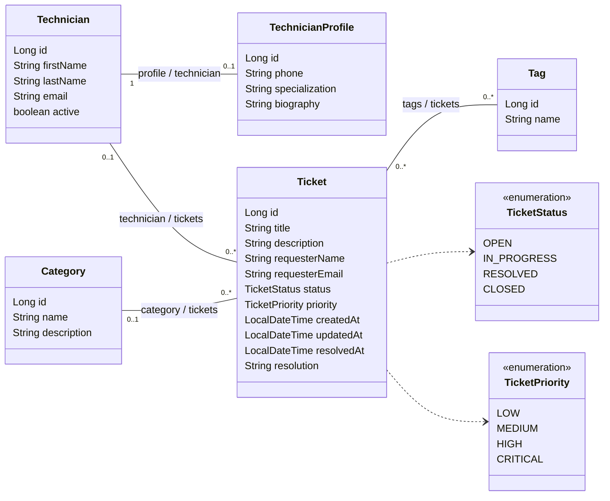

# Architecture

## Vue d'ensemble

Application MVC monolithique avec couche Service. Les éléments en pointillés ne sont **pas encore développés**.

| Package `com.helpdeskpro` | Responsabilité | État |
|---|---|---|
| `entity` | Entités JPA et enums | Implémenté |
| `repository` | Accès aux données, requêtes de recherche | Implémenté |
| `config` | Installation de la base de démonstration, horloge injectable (`Clock`) | Implémenté |
| `service` | Règles métier et transactions | Implémenté |
| `dto` | Requêtes validées (`*Request`) et réponses (`*Response`) | Implémenté |
| `exception` | Exceptions métier | Implémenté (traduction HTTP à faire) |
| `controller` | Contrôleurs MVC et vues | À développer |
| `controller.rest` | API REST | À développer |

Les packages à développer contiennent seulement un `package-info.java` décrivant leur rôle.

## Couche Service

Cinq services (`TicketService`, `TechnicianService`, `TechnicianProfileService`, `CategoryService`, `TagService`), transactionnels (`@Transactional`, lectures en `readOnly`) et validés (`@Validated`, `@Valid` sur les requêtes : `ConstraintViolationException` en cas de champ invalide). Ils reçoivent des `*Request` et renvoient des `*Response` : **aucune entité ne sort de la couche Service**, et les réponses sont entièrement chargées dans la transaction, donc sans `LazyInitializationException`. Les contrôleurs n'ont qu'à appeler un service.

### Exceptions

| Exception | Cas |
|---|---|
| `ResourceNotFoundException` | Identifiant inexistant |
| `DuplicateResourceException` | Nom de catégorie ou de tag, e-mail de technicien déjà pris (sans distinction de casse) |
| `BusinessRuleException` | Règle métier violée : transition interdite, suppression d'une entité encore liée, etc. |

Les messages sont en français et destinés à l'utilisateur. Leur traduction en réponses HTTP (404, 409, 422…) reste à écrire avec les contrôleurs.

### Règles du ticket

| Règle | Détail |
|---|---|
| Création | Toujours `OPEN` ; priorité `MEDIUM` par défaut. Statut, solution, technicien, catégorie et tags ne se règlent jamais par `create` ni `update` |
| Transitions | `OPEN` → `IN_PROGRESS` → `RESOLVED` → `CLOSED`, via `changeStatus`. Tout le reste est refusé |
| Passage en cours | Technicien actif obligatoire |
| Résolution | Solution non vide obligatoire ; `resolvedAt` renseigné par l'horloge |
| Ticket clôturé | Plus aucune modification (champs, statut, technicien, catégorie, tags). Seule la suppression reste possible |
| Affectation / réaffectation | Technicien actif uniquement, ticket `OPEN` ou `IN_PROGRESS` |
| Désaffectation | Ticket `OPEN` uniquement |
| Catégorie, tags | Modifiables tant que le ticket n'est pas clôturé |
| Suppression d'un ticket | Autorisée quel que soit le statut ; technicien, catégorie et tags sont conservés |
| Désactivation d'un technicien | Refusée s'il a un ticket `IN_PROGRESS` |
| Suppression d'un technicien, d'une catégorie, d'un tag | Refusée tant qu'un ticket y est lié ; le message indique le nombre de tickets. La suppression d'un technicien supprime son profil |

Un ticket résolu mais non clôturé peut encore être édité (champs descriptifs, catégorie, tags) ; seule la réaffectation est fermée.

### Délais de résolution

Échéance = `createdAt` + objectif de la priorité, en heures calendaires : `LOW` 72 h, `MEDIUM` 48 h, `HIGH` 24 h, `CRITICAL` 4 h (`TicketPriority.getResolutionTarget()`). Modifier la priorité déplace donc l'échéance.

- Ticket `OPEN` ou `IN_PROGRESS` : `overdue` vaut `true` si l'horloge dépasse strictement l'échéance ; `findOverdue()` les liste, le plus en retard d'abord.
- Ticket `RESOLVED` ou `CLOSED` : jamais en retard ; `resolvedWithinTarget` indique si `resolvedAt` ≤ échéance (`null` tant que le ticket est actif).
- L'horloge est un bean `Clock` (`ClockConfig`) ; les tests la remplacent par une horloge modifiable. `createdAt` et `updatedAt` restent posés par l'entité avec l'horloge système.

### Recherche

Insensible à la casse, par motif `LIKE` dont `%`, `_` et `!` sont échappés. Un mot-clé vide désactive le filtre.

| Service | Recherche |
|---|---|
| Ticket | Mot-clé (titre, description, demandeur, e-mail) + statut, priorité, technicien, catégorie, tag |
| Technicien | Mot-clé (prénom, nom, e-mail) + actif/inactif |
| Profil | Spécialisation, nom ou e-mail du technicien ; `findByTechnicianId` |
| Catégorie | Nom, description |
| Tag | Nom |

### Normalisation

Noms, titres et libellés : espaces de début et de fin retirés, espaces répétés réduits. E-mails : minuscules. Descriptions, solutions et biographies : seulement rognées (retours à la ligne conservés). Champs facultatifs vides : stockés à `null`.

## Modèle de données

## Mapping des relations

| Relation | Propriétaire | Clé étrangère | Côté inverse | Cascade |
|---|---|---|---|---|
| Technician 1—0..1 TechnicianProfile | `TechnicianProfile.technician` | `technician_profile.technician_id`, `NOT NULL`, `UNIQUE` | `mappedBy = "technician"` | `ALL` + `orphanRemoval` depuis Technician |
| Technician 0..1—* Ticket | `Ticket.technician` | `ticket.technician_id`, nullable | `mappedBy = "technician"` | Aucune |
| Category 0..1—* Ticket | `Ticket.category` | `ticket.category_id`, nullable | `mappedBy = "category"` | Aucune |
| Ticket *—* Tag | `Ticket.tags` | Table `ticket_tag`, clé primaire composite | `mappedBy = "tags"` | Aucune |

Contraintes d'unicité : `technician.email`, `category.name`, `tag.name`, `technician_profile.technician_id`.

## Choix techniques

- **Le profil possède la clé étrangère.** La base garantit qu'un profil n'existe pas sans technicien. Contrepartie : Hibernate charge le profil dès qu'il charge un technicien ; utiliser un `@EntityGraph` ou un `join fetch` pour les listes.
- **Pas de remplacement direct du profil.** Hibernate insère avant de supprimer, ce qui violerait l'unicité. `assignProfile` refuse un second profil : le modifier, ou le retirer, vider le contexte (`flush`), puis en assigner un autre.
- **Suppressions.** La base refuse de supprimer un technicien, une catégorie ou un tag encore lié à un ticket. La couche Service vérifie d'abord et refuse proprement avec un message explicite. Supprimer un ticket retire ses lignes `ticket_tag` et conserve les tags.
- **Synchronisation.** Les méthodes `assign*`, `add*` et `remove*` mettent à jour les deux côtés. Les collections exposées sont en lecture seule.
- **Identité.** `equals` repose sur l'identifiant et `hashCode` est constant par type : stable avant et après persistance, compatible avec les proxys, sans récursion.
- **Dates.** `createdAt` et `updatedAt` sont gérées par `@PrePersist` et `@PreUpdate`. `resolvedAt` est posée par `TicketService` (horloge injectable).
- **Contraintes CHECK.** Hibernate génère les contraintes CHECK des enums (colonnes `VARCHAR`) avec le dialecte H2 standard. H2 2.4.240 les liait à la connexion créatrice de la table (erreur 23514 après sa fermeture, [issue 4302](https://github.com/h2database/h2database/issues/4302)) ; corrigé dans H2 2.5.250, version fixée à 2.5.252 dans le `pom.xml`. Les tests `insertsStillWorkOnceTheConnectionThatCreatedTheSchemaIsClosed` (non-régression) et `databaseRejectsInvalidEnumValues` (valeur invalide refusée) couvrent ce point.
- **Session fermée avant la vue** (`open-in-view=false`) : les données nécessaires doivent être chargées dans la couche Service.

## Persistance

| Contexte | URL | Schéma |
|---|---|---|
| Application | `jdbc:h2:file:./data/runtime/helpdesk` | `update` |
| Tests | Base H2 en mémoire ou fichier temporaire | `create-drop` (mémoire), `update` (fichier) |

Le chemin est relatif : lancer l'application depuis la racine du projet. L'initialisation est décrite dans [data/README.md](../data/README.md).
