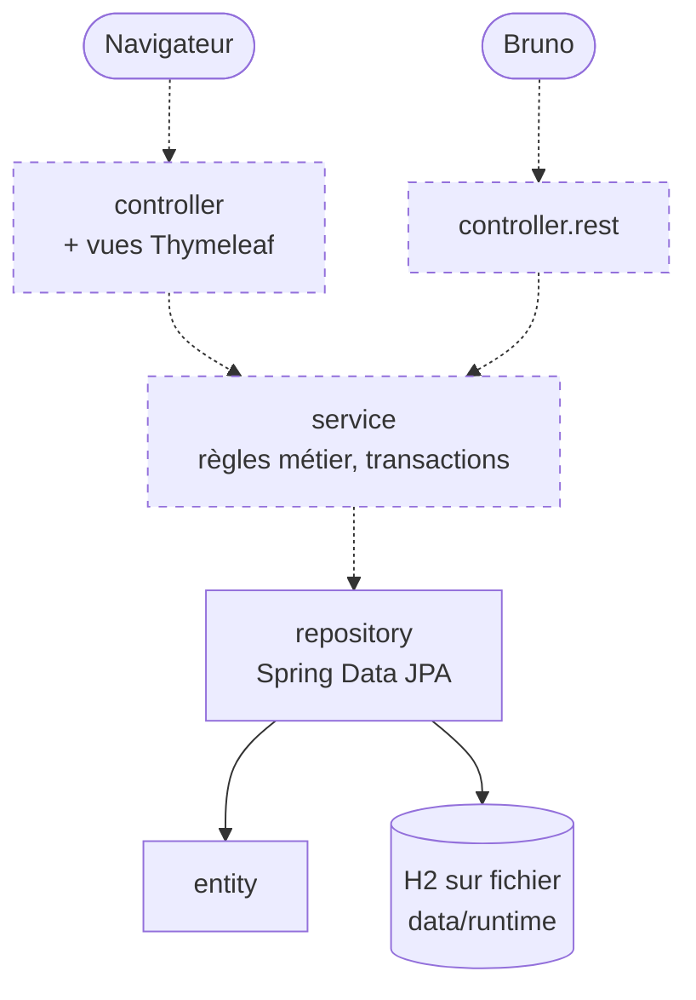
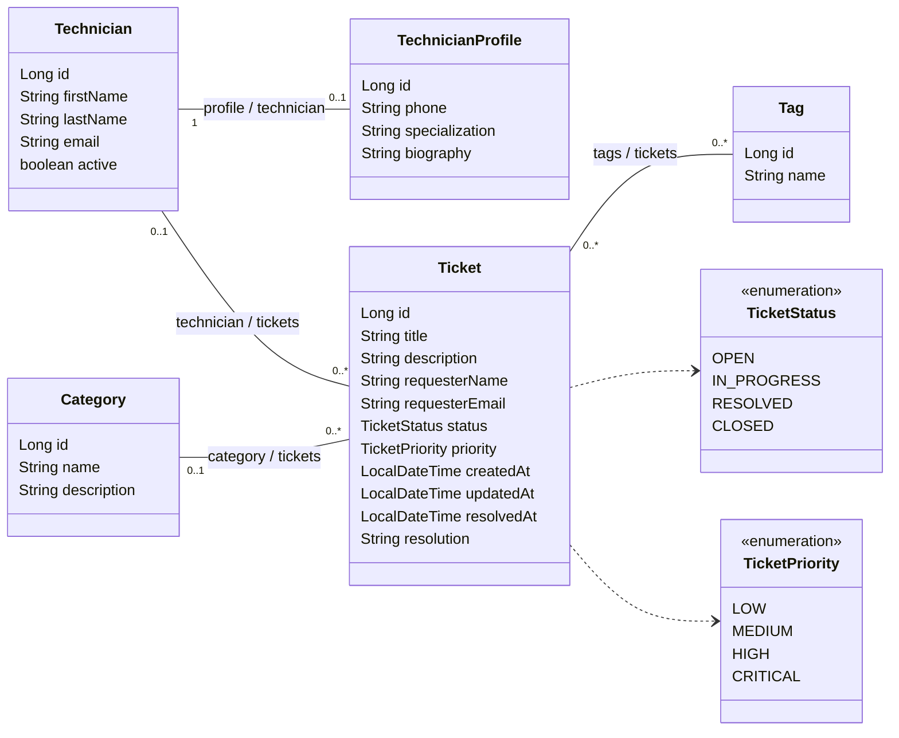

# Architecture

## Vue d'ensemble

Application MVC monolithique avec couche Service. Les éléments en pointillés ne sont **pas encore développés**.

| Package `com.helpdeskpro` | Responsabilité | État |
|---|---|---|
| `entity` | Entités JPA et enums | Implémenté |
| `repository` | Accès aux données | Implémenté (CRUD hérité, sans recherche) |
| `config` | Installation de la base de démonstration | Implémenté |
| `service` | Règles métier et transactions | À développer |
| `controller` | Contrôleurs MVC et vues | À développer |
| `controller.rest` | API REST | À développer |
| `dto` | Objets d'échange | À développer |
| `exception` | Exceptions métier | À développer |

Les packages à développer contiennent seulement un `package-info.java` décrivant leur rôle.

## Modèle de données

## Mapping des relations

| Relation | Propriétaire | Clé étrangère | Côté inverse | Cascade |
|---|---|---|---|---|
| Technician 1—0..1 TechnicianProfile | `TechnicianProfile.technician` | `technician_profile.technician_id`, `NOT NULL`, `UNIQUE` | `mappedBy = "technician"` | `ALL` + `orphanRemoval` depuis Technician |
| Technician 0..1—* Ticket | `Ticket.technician` | `ticket.technician_id`, nullable | `mappedBy = "technician"` | Aucune |
| Category 0..1—* Ticket | `Ticket.category` | `ticket.category_id`, nullable | `mappedBy = "category"` | Aucune |
| Ticket *—* Tag | `Ticket.tags` | Table `ticket_tag`, clé primaire composite | `mappedBy = "tags"` | Aucune |

Contraintes d'unicité : `technician.email`, `category.name`, `tag.name`, `technician_profile.technician_id`.

## Choix techniques

- **Le profil possède la clé étrangère.** La base garantit qu'un profil n'existe pas sans technicien. Contrepartie : Hibernate charge le profil dès qu'il charge un technicien ; utiliser un `@EntityGraph` ou un `join fetch` pour les listes.
- **Pas de remplacement direct du profil.** Hibernate insère avant de supprimer, ce qui violerait l'unicité. `assignProfile` refuse un second profil : le modifier, ou le retirer, vider le contexte (`flush`), puis en assigner un autre.
- **Suppressions.** La base refuse de supprimer un technicien, une catégorie ou un tag encore lié à un ticket. La couche Service devra dissocier d'abord. Supprimer un ticket retire ses lignes `ticket_tag` et conserve les tags.
- **Synchronisation.** Les méthodes `assign*`, `add*` et `remove*` mettent à jour les deux côtés. Les collections exposées sont en lecture seule.
- **Identité.** `equals` repose sur l'identifiant et `hashCode` est constant par type : stable avant et après persistance, compatible avec les proxys, sans récursion.
- **Dates.** `createdAt` et `updatedAt` sont gérées par `@PrePersist` et `@PreUpdate`. `resolvedAt` relèvera de la couche Service.
- **Contraintes CHECK.** Hibernate génère les contraintes CHECK des enums (colonnes `VARCHAR`) avec le dialecte H2 standard. H2 2.4.240 les liait à la connexion créatrice de la table (erreur 23514 après sa fermeture, [issue 4302](https://github.com/h2database/h2database/issues/4302)) ; corrigé dans H2 2.5.250, version fixée à 2.5.252 dans le `pom.xml`. Les tests `insertsStillWorkOnceTheConnectionThatCreatedTheSchemaIsClosed` (non-régression) et `databaseRejectsInvalidEnumValues` (valeur invalide refusée) couvrent ce point.
- **Session fermée avant la vue** (`open-in-view=false`) : les données nécessaires doivent être chargées dans la couche Service.

## Persistance

| Contexte | URL | Schéma |
|---|---|---|
| Application | `jdbc:h2:file:./data/runtime/helpdesk` | `update` |
| Tests | Base H2 en mémoire ou fichier temporaire | `create-drop` (mémoire), `update` (fichier) |

Le chemin est relatif : lancer l'application depuis la racine du projet. L'initialisation est décrite dans [data/README.md](../data/README.md).
